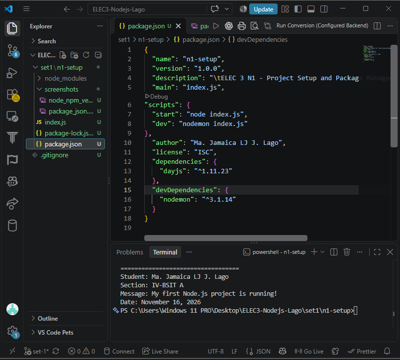
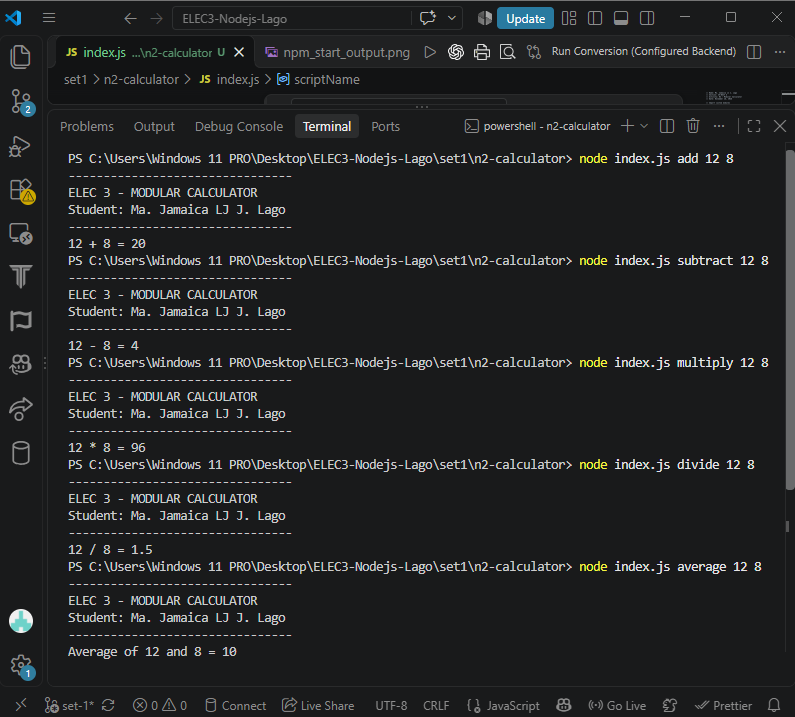
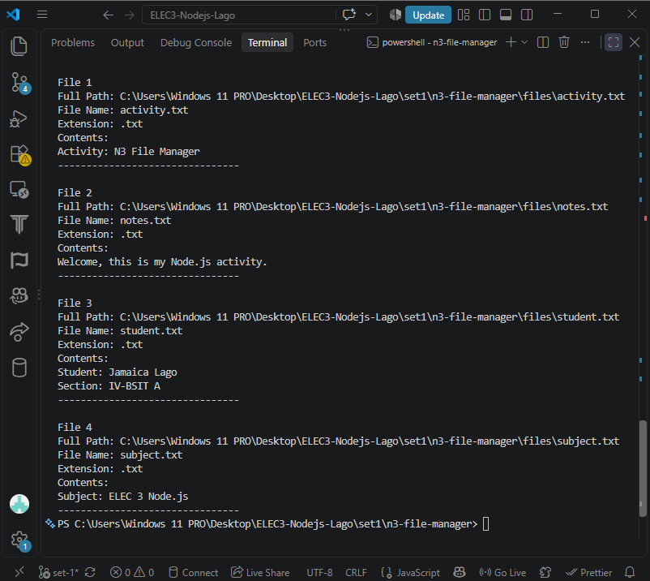

# ELEC 3 - Node.js Activities

**Name:** Ma. Jamaica LJ J. Lago  
**Section:** IV-BSIT A  
**Course:** ELEC 3 - Node.js  
**Set:** 1

## Project Overview

This repository contains my ELEC 3 Node.js activities for Set 1. The activities demonstrate npm package management, JavaScript modules, command-line arguments, and file system operations.

## Set 1 Activities

| Activity | Description | Folder |
|---|---|---|
| N1 - Project Setup | Initialize a Node.js project, install npm packages, and run an application using npm start. | [N1](set1/n1-setup) |
| N2 - Modular Calculator | Perform five mathematical operations using custom Node.js modules. | [N2](set1/n2-calculator) |
| N3 - File Manager | Create, read, update, delete, and list text files using fs and path. | [N3](set1/n3-file-manager) |

## How to Run

### N1 - Project Setup

```bash
cd set1/n1-setup
npm install
npm start
```

### N2 - Modular Calculator

```bash
cd set1/n2-calculator
node index.js add 12 8
node index.js subtract 12 8
node index.js multiply 12 8
node index.js divide 12 8
node index.js average 12 8
```

### N3 - File Manager

```bash
cd set1/n3-file-manager
node index.js list
node index.js read notes.txt
node index.js create sample.txt "Hello Node.js"
node index.js update sample.txt "Updated content"
node index.js delete sample.txt
```

## Screenshots

### N1 - Project Setup


### N2 - Modular Calculator


### N3 - File Manager

## Technologies Used

- Node.js
- JavaScript
- npm
- Visual Studio Code
- Git and GitHub

## Author

Ma. Jamaica LJ J. Lago  
IV-BSIT A
